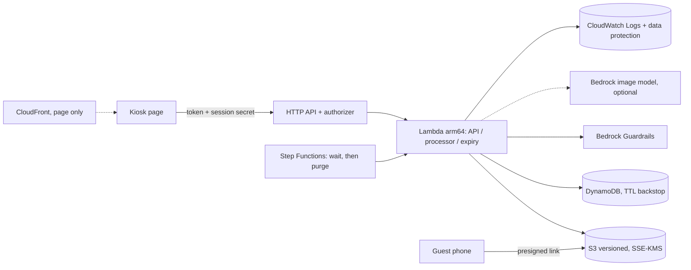

# Privacy-First AI Photo Kiosk

[中文说明](README.zh-CN.md)

> **Prototype, not for production.** This repository is a reference implementation for
> demonstration and learning. You are responsible for any deployment and use and for its
> consequences. Evaluate it with your own security and legal teams under the
> [AWS shared responsibility model](https://aws.amazon.com/compliance/shared-responsibility-model/)
> before any use beyond a disposable sandbox account. **Nothing here constitutes legal advice**, and
> the project makes no statement that any law or regulation is satisfied; whether specific rules
> apply is for counsel to assess. See the [production hardening checklist](docs/handover.md#production-hardening-checklist).

A photo-kiosk backend where data protection is the first design constraint: no image is kept
after the session, deletion is explicit and checked, logs hold no personal data, consent is
recorded without image content, and the whole stack is pinned to one AWS Region by a parameter.
The scenario is generic: a device maker runs AI photo kiosks (here: stylized pictures) and plans
to roll out to more countries. No face recognition and no identity matching are performed.

What it does:
- Shows a notice (purpose, retention, deletion) and records consent bound to the exact notice text; declining creates nothing.
- Processes one synthetic sample picture per session with a fixed style (in-Lambda transformation, or an Amazon Bedrock image model), with Amazon Bedrock Guardrails image filters on input and output.
- Deletes the input with every object version right after processing; deletes everything on request or when the retention period ends, and returns a signed deletion receipt.
- Shares the result through a short-lived presigned link and QR code.
- Writes allowlisted audit events; CloudWatch Logs data protection masks anything that slips through.
- Includes compliance review templates: [data flow](docs/compliance/data-flow.md), [data inventory](docs/compliance/data-inventory.md), [retention and deletion](docs/compliance/retention-and-deletion.md), [third parties and cross-border](docs/compliance/third-parties-and-cross-border.md).

## Architecture



Details, trust boundaries, trade-offs and the fact check: [docs/architecture.md](docs/architecture.md).
Threat model: [THREAT_MODEL.md](THREAT_MODEL.md). Decisions: [DECISIONS.md](DECISIONS.md).

## Prerequisites and cost

- A disposable, non-production AWS account; credentials in the shell environment; the target
  region bootstrapped for CDK (`cdk bootstrap`, done once by the account owner).
- Python with [uv](https://docs.astral.sh/uv/), Node.js (for `npx aws-cdk@2`), AWS CLI v2, rsync.
  Docker is not needed.
- For `image_model.provider=bedrock`: access to the chosen model in the region (see
  [model access](https://docs.aws.amazon.com/bedrock/latest/userguide/model-access.html)). This
  project never changes account-level settings.

Cost: billing dimensions are API Gateway requests, Lambda requests and duration, Step Functions
state transitions, S3 storage and requests, DynamoDB on-demand requests, KMS keys and requests,
Secrets Manager secrets, CloudWatch Logs ingestion, storage and data protection, Bedrock Guardrails
usage, Bedrock image model invocations (if enabled) and
CloudFront requests. See the official pricing pages:
[API Gateway](https://aws.amazon.com/api-gateway/pricing/),
[Lambda](https://aws.amazon.com/lambda/pricing/),
[Step Functions](https://aws.amazon.com/step-functions/pricing/),
[S3](https://aws.amazon.com/s3/pricing/),
[DynamoDB](https://aws.amazon.com/dynamodb/pricing/),
[KMS](https://aws.amazon.com/kms/pricing/),
[Secrets Manager](https://aws.amazon.com/secrets-manager/pricing/),
[CloudWatch](https://aws.amazon.com/cloudwatch/pricing/),
[Bedrock](https://aws.amazon.com/bedrock/pricing/),
[CloudFront](https://aws.amazon.com/cloudfront/pricing/). No free tier is assumed. An
[AWS Budgets](https://docs.aws.amazon.com/cost-management/latest/userguide/budgets-managing-costs.html)
alert on the sandbox account is recommended.

## Deploy

The only place with deployment commands; other documents refer here.

```bash
make init                 # dependencies; creates config/params.json from config/params.example.json
# edit config/params.json (region, retention, model); see docs/deployment-guide.md
make preflight            # read-only: account (last 4 digits) and region confirmation, tools, services
make deploy               # bundle, cdk diff (refuses deletions/replacements unless ALLOW_DESTRUCTIVE=1), deploy
```

Non-interactive: `CONFIRM_ACCOUNT=<last 4 digits> make deploy`. Other parameter files:
`make deploy PARAMS=config/<file>.json`. Example files: `params.example.json` (sandbox,
us-east-1, no model call), `params.handover.example.json` (us-west-2, in-region Bedrock model,
data retained on destroy), `params.cris-bedrock.example.json` (us-east-1, Bedrock through the US
cross-Region inference profile; explicit opt-in).

## Use and verify

```bash
make verify               # end-to-end against the deployed stack (D1-D5, denial paths, logs)
make kiosk-token          # prints the kiosk device token for the page's setup screen (screen only)
```

Open the `KioskUrl` output in a browser, enter the token, then follow the
[demo script](docs/demo-script.md). The e2e report is written to `out/e2e_report.json`.

## Troubleshooting

| Symptom | Cause and fix |
|---|---|
| synth fails with `invalid parameter file` | the message lists every problem; fix `config/params.json` |
| synth fails: `allow_cross_region_inference=true` | the model id is a `us.`/`eu.`/… profile; set the flag only after reviewing [cross-border](docs/compliance/third-parties-and-cross-border.md) |
| `deploy` stops with "deletes or replaces resources" | review the diff; re-run with `ALLOW_DESTRUCTIVE=1` if intended |
| API returns 401 / 403 | missing / wrong `X-Kiosk-Token` |
| status `failed`, reason `downstream_error` | model or guardrail call failed (fail closed); see the audit log `processing_failed.error_code` |
| status `rejected`, reason `input_blocked` | the image filter blocked the picture (false positives happen) |
| download link returns 403 | the link expired, the session was deleted, or the signature is older than the link lifetime |
| `deletion_incomplete` (424) | a version could not be listed/deleted; retry; the workflow and lifecycle retry as well |

## Security and limits

See [SECURITY.md](SECURITY.md), [SECURITY-NOTES.md](SECURITY-NOTES.md) and
[THREAT_MODEL.md](THREAT_MODEL.md). Main limits: one shared kiosk device token; presigned links are
bearer links until they expire; HTTP APIs have no WAF integration; content filters can be wrong;
CloudFront (if enabled) is a global service serving the static page only.

## Clean up

```bash
make destroy              # cdk destroy + leftovers, asks twice (CONFIRM_STACK=<name> CONFIRM_DATA=yes)
make verify-cleanup       # read-only residual check; non-zero exit if anything is left
```

Not removed by `cdk destroy` alone (handled by `make destroy` unless noted):
- the log group of the CDK auto-delete-objects handler (`/aws/lambda/<stack>-CustomS3AutoDeleteObjects…`);
- with `removal_policy=retain`: the image bucket (all versions), the session table, the log groups
  and the KMS keys (deleted only after the second confirmation);
- Secrets Manager secrets in their recovery window (force-deleted by `make destroy`);
- this project's objects in the shared CDK bootstrap assets bucket (only this project's objects are
  deleted, identified by the asset manifests; CDK's shared provider packages and the CDKToolkit stack
  are left alone);
- KMS keys are **scheduled** for deletion (pending window), not deleted at once; `make verify-cleanup`
  prints their deletion date.

Do not assume everything is gone because a command finished: run `make verify-cleanup`.
Details: [docs/cleanup.md](docs/cleanup.md).

## Repository layout

```
config/             parameter templates (*.example.json); config/params.json is git-ignored
infra/              CDK app, stack, synth-time parameter validation
src/kiosk/          session service, imaging, audit allowlist, AWS and in-memory adapters
src/handlers/       Lambda handlers (API, authorizer, processor, expiry)
web/                kiosk page (no inline scripts, synthetic canvas samples)
scripts/            preflight, deploy, e2e, cleanup, residual check, region check, local server, demo
tests/              unit, moto/Stubber adapter tests, synth + cdk-nag tests
sample-data/        manifest of synthetic samples, audit log sample (images are generated)
docs/               architecture, deployment, demo, handover, cleanup, prior art, compliance templates
```

## Local testing

```bash
make lint test            # ruff + pytest (in-memory, moto, Stubber; no AWS)
make synth synth-regions  # cdk synth + cdk-nag for three parameter files and two regions (no credentials)
make demo-offline         # D1-D6 in local mode with a pass/fail summary
make local                # kiosk page + API on http://127.0.0.1:8080 with in-memory adapters
make scan                 # gitleaks (history + canary), detect-secrets, zizmor, osv-scanner
```

## Contributing

See [CONTRIBUTING.md](CONTRIBUTING.md).

## Security

See [CONTRIBUTING](CONTRIBUTING.md#reporting-security-issues) and [SECURITY.md](SECURITY.md) for
more information.

## License

This library is licensed under the MIT-0 License. See the [LICENSE](LICENSE) file.
