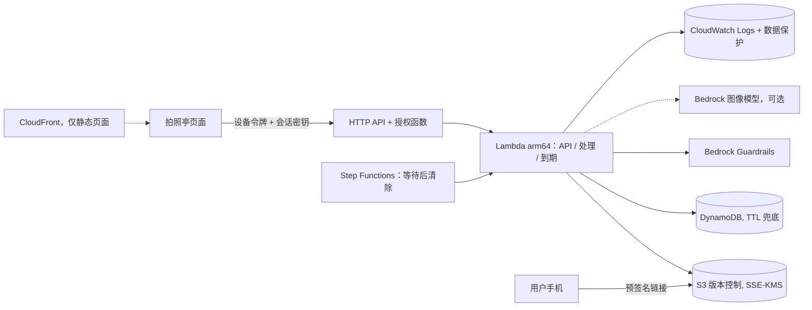

# 隐私优先 AI 拍照亭（Privacy-First AI Photo Kiosk）

[English](README.md)

> **Prototype，不用于生产。** 本仓库是用于演示和学习的参考实现。部署、使用及其后果由使用方负责。
> 在一次性沙箱账号之外使用前，请按 [AWS 责任共担模型](https://aws.amazon.com/compliance/shared-responsibility-model/)
> 与自己的安全和法务团队评估。**本项目不构成法律意见**，也不声称满足任何具体法规；具体法规是否适用由法务评估。
> 见[上生产前的加固清单](docs/handover.md#production-hardening-checklist)。

一个把数据保护当作第一设计约束的拍照亭后端：会话结束后不保留任何图像；删除是显式执行并经过核对的；日志不含个人信息；
同意凭据不含图像内容；整套栈通过一个参数固定在一个 AWS 区域。场景是通用的：某影像设备厂商运营 AI 拍照亭（这里做风格化图片），
计划推广到更多国家。不做人脸识别，不做身份比对。

功能：
- 展示用途、保留期、删除方式，并记录与告知文本精确绑定的同意；拒绝则什么都不创建。
- 每个会话处理一张合成示例图（Lambda 内变换，或 Amazon Bedrock 图像模型），输入和输出都经过 Amazon Bedrock Guardrails 图像过滤。
- 处理结束立即删除输入图的所有对象版本；用户请求或保留期到期时删除全部数据，并返回签名的删除凭据。
- 用短期预签名链接和二维码分享结果。
- 只写白名单字段的审计事件；CloudWatch Logs 数据保护策略作为第二层遮蔽。
- 附合规评审材料模板：[数据流](docs/compliance/data-flow.md)、[数据清单](docs/compliance/data-inventory.md)、[保留期与删除](docs/compliance/retention-and-deletion.md)、[第三方与跨境](docs/compliance/third-parties-and-cross-border.md)。

## 架构

细节、信任边界、取舍和事实核对见 [docs/architecture.md](docs/architecture.md)；威胁模型见 [THREAT_MODEL.md](THREAT_MODEL.md)；设计决策见 [DECISIONS.md](DECISIONS.md)。

## 前置条件与成本

- 一次性的非生产 AWS 账号；凭证在 shell 环境变量中；目标区域已完成 CDK bootstrap（由账号所有者执行一次）。
- 装有 [uv](https://docs.astral.sh/uv/) 的 Python、Node.js（用于 `npx aws-cdk@2`）、AWS CLI v2、rsync。不需要 Docker。
- 若 `image_model.provider=bedrock`：所在区域需能访问所选模型（见[模型访问](https://docs.aws.amazon.com/bedrock/latest/userguide/model-access.html)）。本项目不修改任何账号级设置。

成本只列计费维度：API Gateway 请求、Lambda 请求与时长、Step Functions 状态转换、S3 存储与请求、DynamoDB 按需请求、
KMS 密钥与请求、Secrets Manager 密钥、CloudWatch Logs 摄取、存储与数据保护、Bedrock Guardrails 用量、Bedrock 图像模型调用（启用时）、
CloudFront 请求。以官方定价页为准：见英文 README 中的链接。不预设免费额度。建议在沙箱账号设置 [AWS Budgets](https://docs.aws.amazon.com/cost-management/latest/userguide/budgets-managing-costs.html) 告警。

## 部署

部署命令只写在英文 [README.md 的 Deploy 一节](README.md#deploy)（`make init` → 编辑 `config/params.json` → `make preflight` → `make deploy`）。
参数说明见 [docs/deployment-guide.md](docs/deployment-guide.md)。

## 使用与验证

见 [README.md 的 Use and verify 一节](README.md#use-and-verify)（`make verify`、`make kiosk-token`）和[演示脚本](docs/demo-script.md)。

## 故障排查

见 [README.md 的 Troubleshooting 一节](README.md#troubleshooting)。常见：401/403 是设备令牌缺失或错误；`input_blocked` 是图像过滤拦截（会有误报）；
链接 403 表示已过期、会话已删除或签名超过链接有效期；`deletion_incomplete`（424）可重试，工作流和生命周期也会重试。

## 安全与局限

见 [SECURITY.md](SECURITY.md)、[SECURITY-NOTES.md](SECURITY-NOTES.md)、[THREAT_MODEL.md](THREAT_MODEL.md)。主要局限：所有拍照亭共用一个设备令牌；
预签名链接在过期前是持有即可用的链接；HTTP API 不能挂 WAF；内容过滤会误判；CloudFront（启用时）是全球服务，只分发静态页面。

## 清理

命令见 [README.md 的 Clean up 一节](README.md#clean-up)（`make destroy` 后执行 `make verify-cleanup`）。

`cdk destroy` 本身不会删除、需要 `make destroy` 处理的资源：
- CDK 自动清空桶处理函数的日志组（`/aws/lambda/<stack>-CustomS3AutoDeleteObjects…`）；
- `removal_policy=retain` 时的图像桶（含所有版本）、会话表、日志组和 KMS 密钥（第二次确认后才删除）；
- 处于恢复期的 Secrets Manager 密钥（`make destroy` 强制删除）；
- 共享 CDK bootstrap 资产桶中属于本项目的对象（按资产清单识别，只删本项目的；CDK 通用 provider 包和 CDKToolkit 栈不动）；
- KMS 密钥进入**计划删除**状态（等待期），不会立即删除；`make verify-cleanup` 会打印删除日期。

不要因为命令执行完就认为已经删干净，请运行 `make verify-cleanup`。详见 [docs/cleanup.md](docs/cleanup.md)。

## 目录结构

见 [README.md 的 Repository layout 一节](README.md#repository-layout)。

## 本地测试

见 [README.md 的 Local testing 一节](README.md#local-testing)：`make lint test`、`make synth synth-regions`、`make demo-offline`、`make local`、`make scan`。全部不需要 AWS。

## 贡献

见 [CONTRIBUTING.md](CONTRIBUTING.md)。

## 安全

见 [CONTRIBUTING](CONTRIBUTING.md#reporting-security-issues) 与 [SECURITY.md](SECURITY.md)。

## 许可证

本项目采用 MIT-0 许可证，见 [LICENSE](LICENSE)。
