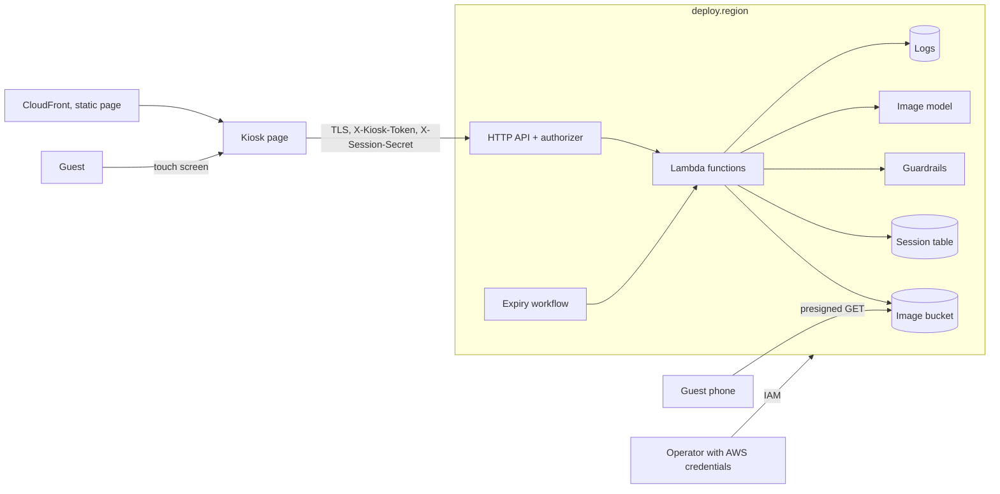

# Threat model

**Status: DRAFT** — to be reviewed with the deploying organisation's security and privacy teams.
This document is not legal advice and makes no statement that any law or regulation is satisfied.

Scope: commit `v0.1.0`, sandbox parameters (`config/params.example.json`), one region.

## 1. Assets

| Asset | Why it matters |
|---|---|
| Guest images (input, result) | images of people are the main privacy risk of a photo kiosk |
| Share links | bearer access to one result image |
| Session id and secret | control over one session (status, link, deletion) |
| Kiosk device token | lets a client create sessions and call the API |
| Consent and deletion evidence | must be trustworthy and must not itself contain personal data |
| Audit and access logs | could leak personal data if written carelessly |
| KMS keys | protect every stored item; the HMAC key makes receipts verifiable |

## 2. Trust boundaries

Untrusted: everything that arrives at the API (headers, path, body, image bytes), the content of
images, and every model response. Semi-trusted: the kiosk device (holds the device token).
Trusted: the AWS account administrators (operators).

## 3. Threats and controls

Each row names the control in code or configuration and the test or check that exercises it.

### T1 Image data leaks from storage
- Private bucket, Block Public Access, TLS-only, SSE-KMS with the region's own key (stack).
- Bucket policy denies GetObject/PutObject to every principal except the API and processor roles,
  including administrators (`DenyImageAccessExceptKioskFunctions`; e2e "operator GetObject denied").
- Images live only for the session: input purged with all versions after processing; result purged
  on request or expiry (`KioskService.process/purge`; tests D1/D3/D4; e2e D1/D3/D4).
- Upload metadata (EXIF/GPS, camera serial numbers, text chunks) is dropped by re-encoding
  (`imaging.sanitize`; test `test_metadata_is_stripped`; e2e "no EXIF/GPS metadata").
- No S3 server access logs or CloudFront viewer logs (they would record phone IP addresses).
- Residual risk: an operator can change the bucket policy; CloudTrail records that. Production:
  restrict policy changes with SCPs (handover).

### T2 Share link forwarded or guessed
- Links are SigV4 presigned for one object key, with a lifetime of at most
  `share_link_ttl_seconds` and never beyond the session end (`KioskService.status`; test
  `test_link_never_outlives_session`).
- The bucket refuses signatures older than the link lifetime (`s3:signatureAge`) and any non-SigV4
  request (`DenyNonSigV4`), so a mistake in the code cannot issue a long-lived link (infra test
  `test_signature_age_follows_parameter`; e2e "link refused after expiry").
- Object keys contain `session_ref` (128 bits derived from a 192-bit random id); not guessable.
- Deletion invalidates the link at once (e2e "share link stops working after deletion").
- Residual risk: within its lifetime a forwarded link works for anyone (bearer). Documented in the
  notice; shorten `share_link_ttl_seconds` if needed.

### T3 Session hijacking
- Session id (192 random bits) in the path and secret (256 random bits) in a header are both
  required; only hashes are stored; constant-time comparison (`ids.py`).
- Unknown session and wrong secret return the same 404 (no oracle;
  `test_wrong_secret_and_unknown_session_look_the_same`).
- Values are kept in page memory only (not in storage or URLs); the access log records the route
  template, not the path (infra test `test_access_log_has_no_ip_or_path`).
- No user accounts exist, so there is nothing to take over beyond one session.
- Residual risk: someone at the kiosk before the guest restarts can act on the open session; the
  page offers Delete and the session expires.

### T4 Instructions embedded in an image (prompt injection)
- Structural control: prompts are fixed server-side constants chosen by an enum key
  (`styles.py`); no text from the request, the image or any model output is placed in a prompt, and
  no language model reads the image. There is no channel through which image text becomes an
  instruction (`test_style_must_be_in_enum`).
- Detection: Guardrails `PROMPT_ATTACK` filter on input images. Tested in the cloud: the synthetic
  "IGNORE ALL PREVIOUS INSTRUCTIONS…" image was blocked as `PROMPT_ATTACK` (VERIFICATION.md).
- Blocked inputs are deleted and never shared (D5).

### T5 Inappropriate model output
- Output images pass the same image content filters before storage (`source=OUTPUT`;
  `test_output_block`).
- Model `finish_reasons` filters map to `model_filtered`; malformed responses (NaN/Infinity, no
  image, bad base64, oversized) are rejected and never shown (`test_model_response_validation`).
- Model free text is never returned or logged.
- Moderation errors fail closed (`test_moderation_unavailable_fails_closed`).
- Residual risk: filters have false negatives and false positives (a harmless test card was blocked
  as HATE in the cloud run). A human review path is out of scope.

### T6 Personal data in logs
- Audit events use an allowlist schema; unknown fields are dropped by name, values must match short
  patterns (`audit.py`; `test_unknown_fields_and_bad_values_are_dropped`,
  `test_full_flows_leave_no_sensitive_data_in_audit`).
- Error messages from AWS or exceptions are never logged; only codes/class names.
- API access log format has no IP, user agent or path.
- CloudWatch Logs data protection policy (audit + mask) on all log groups as a second layer; e2e
  canary shows e-mail and IP masked. Its detection is pattern/keyword based and covers only the
  configured identifiers (architecture.md fact check).
- Library log lines are kept out (`wiring.py`).
- Residual risk: operators with `logs:Unmask` can see masked values; there should be none.

### T7 Incomplete deletion (versions, backups, copies)
- Purge lists every version and delete marker under the session prefix (paginated), deletes them in
  batches, aborts multipart uploads, lists again and retries; the receipt reports what remains
  (`S3ObjectStore._purge`; moto tests with pagination; negative control shows a plain delete leaves
  versions).
- A non-zero remainder returns 424 and an audit event; the workflow retries; lifecycle and TTL are
  the backstop.
- No PITR, no backups, no replication, no Object Lock (retention-and-deletion.md).
- Expiry runs even if the guest walks away (Step Functions Wait), and on access after expiry.
- Residual risk: copies outside the system (downloaded file on the phone, screen captures).

### T8 Abuse of the API (cost, flooding, uploads)
- Kiosk device token checked by a Lambda authorizer on every route (e2e 401/403).
- Stage throttling (best effort per the API Gateway docs), body size limits before decoding,
  decompression-bomb guard, one photo per session.
- Residual risk: the device token is a shared secret; anyone who extracts it from a kiosk can call
  the API within the throttle. HTTP APIs do not support AWS WAF; production options in handover.

### T9 Region and transfer
- All regional resources in `deploy.region`; validated at synth; `region_check.py` in CI for two
  regions; cross-region inference only with an explicit flag; global profiles refused.

### T10 Consent integrity
- Consent must echo the notice version and SHA-256 of the exact text shown; stale notices are
  refused (409). Receipts are HMAC-signed with a KMS key that never leaves KMS.
- Declining creates nothing.

## 4. Out of scope
Physical kiosk security, camera hardware, operator insider threats beyond IAM, guest identity
(there is none), payment and printing.
