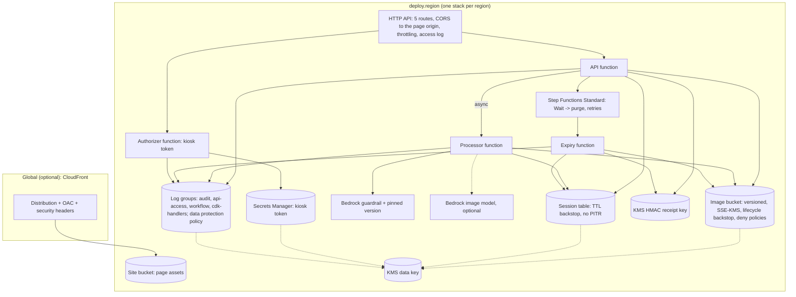

# Architecture

Applies to commit `v0.1.0`. The mermaid diagrams in this file are the source of truth. This
document is not legal advice and makes no statement that any law or regulation is satisfied.

## Components



| Component | Code |
|---|---|
| Session service (consent, processing, share, deletion) | `src/kiosk/service.py` |
| Upload validation and re-encoding | `src/kiosk/imaging.py` |
| AWS adapters (DynamoDB, S3 purge, Step Functions, Guardrails, Bedrock, KMS HMAC, Lambda) | `src/kiosk/aws.py` |
| In-memory adapters (local mode, tests) | `src/kiosk/local.py` |
| Audit allowlist | `src/kiosk/audit.py` |
| Handlers | `src/handlers/` |
| Stack and parameter validation | `infra/kiosk_infra/` |
| Kiosk page | `web/` |

## Request flow

```mermaid
sequenceDiagram
  participant K as Kiosk page
  participant A as API (+authorizer)
  participant P as Processor
  participant S as S3
  participant W as Expiry workflow
  K->>A: GET /notice
  K->>A: POST /sessions {consent, notice_version, notice_sha256}
  A->>W: StartExecution exp-<ref> (wait = retention)
  A-->>K: 201 session_id, session_secret, signed consent receipt
  K->>A: POST /sessions/{id}/photo (image, style key)
  A->>S: put s/<ref>/input.png (re-encoded)
  A-)P: invoke async {session_ref}
  A-->>K: 202 processing
  P->>S: get input; Guardrails(input); model; Guardrails(output); put result.png
  P->>S: delete every version of input.png
  K->>A: GET /sessions/{id}
  A-->>K: ready + presigned link (<= link TTL, <= session end) + QR
  alt guest deletes
    K->>A: DELETE /sessions/{id}
    A->>S: delete all versions + markers under s/<ref>/
    A->>W: StopExecution
    A-->>K: signed deletion receipt
  else retention ends
    W->>S: (expiry function) delete all versions + record
  end
```

## Trust boundaries and deployment topology

See [THREAT_MODEL.md](../THREAT_MODEL.md) for the boundary diagram. Topology: one stack per region,
named by `deploy.stack_name`; all names derive from `deploy.resource_prefix`. A second country is a
second parameter file and a second stack in its region; stacks share nothing.

## Trade-offs and limits

- **No in-region Bedrock image model in us-east-1** on 2026-10-21; the sandbox default uses the
  in-Lambda `transform` provider. Bedrock was tested through the `us.` profile with the opt-in, and
  the handover example uses an in-region model in us-west-2.
- **Input stored briefly** because processing is asynchronous.
- **HTTP API**: no WAF, no API keys (see DECISIONS).
- **Shared device token** for kiosk authentication.
- **Filters are probabilistic**; a harmless test card was blocked as HATE.
- **CloudFront is global** (static page only); optional.
- **No human review**, no printing, no payment, no camera.
- Performance: no figures are given. Measure with `scripts/e2e_aws.py` (it prints time-to-ready per
  run) under your own load; billing dimensions are on the pricing pages linked in the README.

## Region differences checked

| Capability | us-east-1 | us-west-2 | Source |
|---|---|---|---|
| Bedrock image model with in-region ON_DEMAND | none listed | `stability.sd3-5-large-v1:0` (also `stable-image-core/ultra`, text-to-image only) | `aws bedrock list-foundation-models --by-output-modality IMAGE`, 2026-10-21 |
| Stability Image Services (control structure etc.) | via `us.` profiles only | via `us.` profiles only | same |
| Guardrails image filters (all six categories) | GA | GA | Guardrails image docs |
| Lambda python3.14 arm64 | yes | yes | Lambda runtimes |

Other regions listed (eu-west-1, eu-central-1, eu-west-2, ap-northeast-1, ap-southeast-1/2, ap-south-1,
eu-north-1) showed no image-output model on that date. `infra/kiosk_infra/params.py` encodes these
findings; `make preflight` checks the live state.

## Fact check

Checked on 2026-10-21 against official documentation or the live API ("tested" = observed in the
sandbox run, see VERIFICATION.md).

| # | Statement | Source |
|---|---|---|
| 1 | Image-output models in us-east-1 are Stability Image Services offered with INFERENCE_PROFILE only; us-west-2 lists `stability.sd3-5-large-v1:0` with ON_DEMAND | live API `aws bedrock list-foundation-models` (us-east-1, us-west-2) |
| 2 | `us.stability.stable-image-control-structure-v1:0` routes to us-east-1, us-east-2, us-west-2 | live API `aws bedrock list-inference-profiles` / `get-inference-profile` |
| 3 | Model agreement status `AVAILABLE` means access exists; first use of a third-party model can start a subscription | https://docs.aws.amazon.com/bedrock/latest/userguide/model-access.html |
| 4 | SD3.5 Large image-to-image fields (`mode`, `image`, `strength`, `output_format`) and `finish_reasons` values | https://docs.aws.amazon.com/bedrock/latest/userguide/model-parameters-diffusion-3-5-large.html |
| 5 | Control Structure fields (`image`, `prompt`, `control_strength`, `style_preset`, `output_format`) and input constraints | https://docs.aws.amazon.com/bedrock/latest/userguide/stable-image-services.html |
| 6 | Guardrails image filters: GA in us-east-1, us-west-2, eu-central-1, ap-northeast-1 for Hate, Insults, Sexual, Violence, Misconduct, Prompt Attack; PNG/JPEG only; work with ApplyGuardrail; text in images evaluated up to a limit | https://docs.aws.amazon.com/bedrock/latest/userguide/guardrails-mmfilter.html |
| 7 | ApplyGuardrail evaluates content without invoking a model; `source` INPUT/OUTPUT; response `action` NONE/GUARDRAIL_INTERVENED | https://docs.aws.amazon.com/bedrock/latest/userguide/guardrails-use-independent-api.html |
| 8 | Prompt-attack image filter blocks an image with embedded instructions when called through ApplyGuardrail (source INPUT) | tested |
| 9 | Geographic cross-Region inference stays within the geography, on the AWS network, encrypted in transit; CloudTrail logs `additionalEventData.inferenceRegion` in the source region | https://docs.aws.amazon.com/bedrock/latest/userguide/cross-region-inference.html ; tested (inferenceRegion us-east-1) |
| 10 | `bedrock:InferenceProfileArn` restricts foundation-model invocation to a given profile | https://docs.aws.amazon.com/bedrock/latest/userguide/inference-profiles-prereq.html ; tested |
| 11 | Model providers have no access to Bedrock logs or customer prompts and completions | https://docs.aws.amazon.com/bedrock/latest/userguide/data-protection.html |
| 12 | S3 lifecycle expiration is asynchronous, in days, with a possible delay; on versioned buckets expiration only affects current versions; `NoncurrentVersionExpiration` and expired delete markers need their own actions | https://docs.aws.amazon.com/AmazonS3/latest/userguide/lifecycle-expire-general-considerations.html |
| 13 | DynamoDB TTL deletes within a few days; expired items remain readable until deleted | https://docs.aws.amazon.com/amazondynamodb/latest/developerguide/howitworks-ttl.html |
| 14 | Presigned URLs from temporary credentials expire no later than the credentials; `s3:signatureAge` can deny old signatures | https://docs.aws.amazon.com/AmazonS3/latest/userguide/using-presigned-url.html |
| 15 | A default S3 client in us-east-1 presigns with SigV2 (no `X-Amz-Date`); a SigV4 client on the regional endpoint is needed for `s3:signatureAge` | tested (moto test `test_default_client_would_presign_sigv2_negative_control`, cloud links checked) |
| 16 | Step Functions Wait `SecondsPath`; Standard workflows support long waits (limit on the page) | https://docs.aws.amazon.com/step-functions/latest/dg/state-wait.html |
| 17 | Step Functions execution history is retained for a fixed period after an execution closes | https://docs.aws.amazon.com/step-functions/latest/dg/service-quotas.html |
| 18 | EventBridge Scheduler invokes with 60-second precision; completed one-time schedules should be deleted | https://docs.aws.amazon.com/scheduler/latest/UserGuide/schedule-types.html |
| 19 | Step Functions trust policy supports `aws:SourceArn` and `aws:SourceAccount` | https://docs.aws.amazon.com/step-functions/latest/dg/procedure-create-iam-role.html |
| 20 | Lambda execution role trust policy is documented with the service principal only | https://docs.aws.amazon.com/lambda/latest/dg/lambda-intro-execution-role.html |
| 21 | CloudWatch Logs data protection: masks at egress for identifiers configured; only events ingested after the policy are masked; `logs:Unmask` shows values; identifiers such as Address, EmailAddress, IpAddress, LatLong, Name (no country code) and country-specific ones (for example PhoneNumber-US); some need nearby keywords | https://docs.aws.amazon.com/AmazonCloudWatch/latest/logs/mask-sensitive-log-data.html ; https://docs.aws.amazon.com/AmazonCloudWatch/latest/logs/CWL-managed-data-identifiers.html ; tested (canary masked) |
| 22 | Data protection policy JSON: one Audit statement with `FindingsDestination`, one Deidentify statement with empty `MaskConfig`, identical identifier lists | https://docs.aws.amazon.com/AmazonCloudWatch/latest/logs/mask-sensitive-log-data-start.html |
| 23 | KMS key deletion waiting period configurable within a fixed range; `PendingDeletion` keys cannot be used | https://docs.aws.amazon.com/kms/latest/developerguide/deleting-keys.html |
| 24 | OAC is recommended over OAI and supports SSE-KMS; bucket policy uses `cloudfront.amazonaws.com` with `AWS:SourceArn` | https://docs.aws.amazon.com/AmazonCloudFront/latest/DeveloperGuide/private-content-restricting-access-to-s3.html |
| 25 | HTTP APIs: no AWS WAF, no API keys or per-client throttling; Lambda authorizers and access logs to CloudWatch supported | https://docs.aws.amazon.com/apigateway/latest/developerguide/http-api-vs-rest.html |
| 26 | HTTP API CORS: API Gateway answers preflight automatically and ignores backend CORS headers | https://docs.aws.amazon.com/apigateway/latest/developerguide/http-api-cors.html |
| 27 | API keys must not be used for authorization; throttling is best effort | https://docs.aws.amazon.com/apigateway/latest/developerguide/api-gateway-api-usage-plans.html |
| 28 | Lambda `python3.14` is supported (Amazon Linux 2023); all supported runtimes run on arm64 | https://docs.aws.amazon.com/lambda/latest/dg/lambda-runtimes.html |
| 29 | AI services opt-out policies cover listed services including Amazon CloudWatch, Rekognition and Textract (not Amazon Bedrock) | https://docs.aws.amazon.com/organizations/latest/userguide/orgs_manage_policies_ai-opt-out_all.html |

Statements that could not be verified were removed. Not claimed: any processing time, any price,
any quota value.
