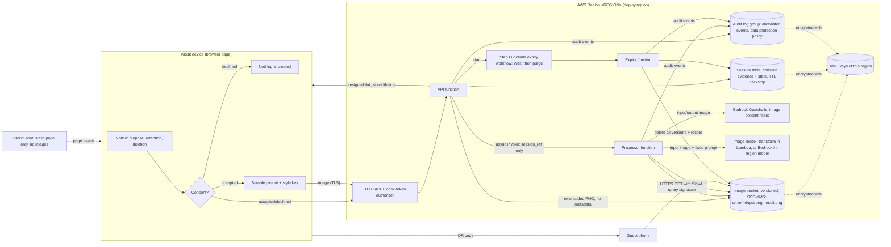

# Data flow (template for compliance review)

> **Template, not a conclusion.** This document describes how the prototype handles data so that
> your privacy and legal teams can assess it. It does not constitute legal advice and makes no
> statement that any law or regulation is satisfied. Which rules apply, and whether this design is
> adequate for them, must be assessed by counsel for each country of deployment.
>
> Fill in the `<...>` placeholders for your deployment. Facts about the prototype refer to commit
> `v0.1.0` and to the parameter file you deploy.

## 1. Flow diagram (source of truth for the review)

If `image_model.allow_cross_region_inference=true`, the Bedrock request goes through a geographic
inference profile and may be processed in another region of that geography. See
[third-parties-and-cross-border.md](third-parties-and-cross-border.md).

## 2. Steps

| # | Step | Data involved | Where | Retained after the step |
|---|---|---|---|---|
| 1 | Notice shown | notice text, version, hash | kiosk page | no |
| 2 | Consent declined | decision, notice version/hash, random receipt id | audit log | audit event only |
| 3 | Consent accepted | consent evidence, session_ref, secret hash, expiry | session table, audit log | until deletion/expiry (table); log retention (audit) |
| 4 | Photo submitted | image (re-encoded PNG, no metadata), style key | image bucket | until processing ends |
| 5 | Content check | image | Bedrock Guardrails in `<REGION>` | not stored by this project |
| 6 | Stylization | image + fixed prompt | Lambda (transform) or Bedrock image model | not stored by this project |
| 7 | Input deleted | - | image bucket | no version left |
| 8 | Share | presigned link (bearer, short lifetime), QR code | kiosk screen, guest phone | link expires |
| 9 | Delete / expiry | result image, record, workflow | bucket, table, workflow | deletion receipt (returned) and audit event |

## 3. Review questions for your team

- Is the purpose statement in the notice (`Settings.notice()` in `src/kiosk/settings.py`) the right one for `<COUNTRY>`?
- Is the retention period (`session.retention_seconds`, default 300 s) appropriate?
- Is the content filter acceptable as a processor of images in `<REGION>`?
- Does the deployment need the CloudFront page, or should the page be served from the kiosk itself (`frontend.enabled=false`)?
- How does a guest request deletion after leaving the kiosk? (see OPEN-QUESTIONS.md)
